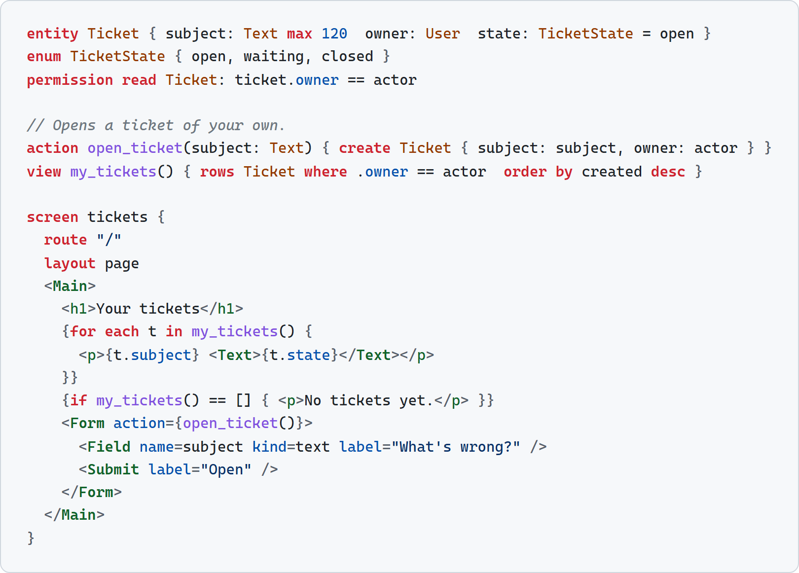

# crudspec

`crudspec` is an experiment: **a compact, checkable language for data-centred web apps**,
which people and AI agents can change safely. A spec describes a whole app (its data, rules,
actions, screens, API and what agents may call), and the compiler checks it as a whole before
compiling it to a Go program that keeps its data in SQLite. Campfire is about a sixth of the code of the
Rails app it reproduces (see Code size below).

- **The connected pieces are validated together.** Links and forms must name real screens and
  actions, forms must fill their actions' parameters, permissions must cover every row a screen
  or view shows, every action must keep the invariants the spec states (proved with Z3), and a
  change is reviewed for what it widens, breaks or puts at risk.
- **Rules carry through every layer.** A size written once (`title: Text max 80`) is a CHECK in
  the database, a refusal in the action, `maxlength` on the form field and `maxLength` in the
  agent schema.
- **Queries are shaped by what the app actually reads:** the indexes they need are derived from
  them and checked against SQLite's own plans, a page's reads are batched, and order and limits
  run in the database.
- **Strong performance:** many times Rails' throughput, at a fraction of its memory (see
  Performance below). Hand-optimized C or Rust can still go further.

<picture>
  <source media="(prefers-color-scheme: dark)" srcset="docs/readme/example-dark.png">
  
</picture>

<details><summary>The example as text</summary>

```
entity Ticket { subject: Text max 120  owner: User  state: TicketState = open }
enum TicketState { open, waiting, closed }
permission read Ticket: ticket.owner == actor

// Opens a ticket of your own.
action open_ticket(subject: Text) { create Ticket { subject: subject, owner: actor } }
view my_tickets() { rows Ticket where .owner == actor  order by created desc }

screen tickets {
  route "/"
  layout page
  <Main>
    <h1>Your tickets</h1>
    {for each t in my_tickets() {
      <p>{t.subject} <Text>{t.state}</Text></p>
    }}
    {if my_tickets() == [] { <p>No tickets yet.</p> }}
    <Form action={open_ticket()}>
      <Field name=subject kind=text label="What's wrong?" />
      <Submit label="Open" />
    </Form>
  </Main>
}
```

</details>

- **An app is a directory.** Every `.crud` file in it is part of the app, with no imports.
- **The UI is HTML.** A lowercase tag is plain HTML, a tag with a dash a web component, and a
  capitalised one a built-in element or a component. Text is written as it shows, values in
  `{…}`, and code in braces. The built-ins are declared in [`lang/std/`](lang/std/ui.crud),
  and the standard library's components are compiled only when an app uses them.
- **Checked as a whole:** names and types, permissions, links and forms, unreachable states,
  query costs against SQLite's own plans, and invariants proven for every action (Z3).
- **Changes are reviewed and upgraded:** `review` reports what a new version widens, breaks or
  puts at risk, and `migrate` upgrades the data, rehearsed on a copy first.
- **Agents call it directly:** every action and view over JSON and MCP, with dry runs,
  confirmation for deletes, idempotency keys, an audit log and `/llms.txt`; people issue
  agent tokens at `/_agents`.

**Try it** (Node 24; Go 1.27 to build):

```
node lang/cli.ts check apps/todomvc            # the checks
node lang/cli.ts build apps/todomvc --out out  # the Go program
out/app --data data --assets apps/todomvc/assets --port 3000   # http://127.0.0.1:3000
```

The language is explained in [`lang/LANGUAGE.md`](lang/LANGUAGE.md), and everything in it is
listed in [`lang/REFERENCE.md`](lang/REFERENCE.md), generated from the compiler.

## Performance

Campfire's room page, each server given the same data and the same 4 CPU cores.

**Speed, as a multiple of Rails** (requests per second)

| | Rails | Rust port | crudspec |
| --- | ---: | ---: | ---: |
| No cache | 1× | 62× | 79× |
| Fragment cache | 1× | 46× | 73× |
| Full-page cache | 1×* | 76× | 156×+ |

**Memory under load**

| | Rails | Rust port | crudspec |
| --- | ---: | ---: | ---: |
| No cache | 967 MB | 98 MB | 131 MB |
| Fragment cache | 913 MB | 52 MB | 105 MB |
| Full-page cache | 913 MB* | 56 MB | 50 MB |

\* Rails has no full-page cache, so this is its fragment cache, its fastest. Measured in WSL2 on one Windows
machine, because of hardware limits in testing; how, and the raw numbers, are in
[`bench/README.md`](bench/README.md).

## Code size

Campfire, in lines of the app's own code:

| | Rails | Rust port | crudspec |
| --- | ---: | ---: | ---: |
| Lines | 10,896 | 49,480 | 1,828 |
| As a multiple of Rails | 1× | 4.5× | 0.17× |

- **Counted:** the app's backend, templates and own browser script, every line. Rails: Ruby,
  views and JavaScript. Rust port: Rust, templates, JavaScript and SQL. crudspec: the spec and a
  small Go file of widgets.
- **Not counted:** stylesheets and images (all three use Rails'), tests and dependencies. The
  frameworks aren't counted either, Rails' and crudspec's own language and runtime, while the
  Rust port writes its own web layer, which is in its count. The Rust port also serves Rails'
  JavaScript, which isn't in its count.

crudspec's other apps, which have no Rails or Rust versions: Desk 461 lines, Tasks 413, TodoMVC 190.

## Layout

| Path | What it is |
| --- | --- |
| [`lang/`](lang/README.md) | **The language**, generic: the guide and reference, the standard library (`lang/std/`), parser, checker, type pass, invariant prover, change review and the compiler to Go (with its runtime library). Nothing in it names an app |
| [`apps/campfire/`](apps/campfire/README.md) | **Campfire, an app written in it**: the spec, the Rails oracle and its scenarios, the equity tests, browser checks |
| [`apps/tasks/`](apps/tasks/README.md) | **A second app**, a small team task tracker, on the same language and runtime with no changes. It shows the language isn't Campfire-shaped |
| [`apps/todomvc/`](apps/todomvc/README.md) | **TodoMVC**, rendered on the server |
| [`app3/`](app3/BRIEF.md) | **Desk**, a helpdesk built from a brief, to test the language on an app nobody designed it for |
| `docs/`, `reports/`, `corpus/`, `h2/`, `baseline/` | **The experiment**: hypotheses, protocol, results |
| `spec/campfire.crud`, `tools/` | The frozen Phase 1 (v1) artefacts: the slice spec, the v1 interpreter, the checker and the scoring tools. They are kept where their tags and reports expect them |

The repository started with the **test plan**, not the implementation. The
question is whether the approach is *worth it*. Each claim has a success
criterion and a kill criterion, decided before anything is built.

| Document | Purpose |
| --- | --- |
| [docs/HYPOTHESES.md](docs/HYPOTHESES.md) | What we want to be true, how we'd measure it, what counts as success, and what would show it isn't valuable |
| [docs/TEST-PROCESS.md](docs/TEST-PROCESS.md) | Phases, gates, protocol rules, baselines, sample sizes and reporting |
| [docs/DESIGN-SKETCH.md](docs/DESIGN-SKETCH.md) | The DSL under test: concepts, example syntax, checks, non-goals |
| [corpus/README.md](corpus/README.md) | The seeded-bug and change-task corpus that every comparison uses |
| [docs/LESSONS-FROM-AGENTLANG.md](docs/LESSONS-FROM-AGENTLANG.md) | What the previous experiment taught, and the rules that follow from it |

Status: **Phase 1 scored; H1 killed** (thresholds approved by delegation; see `docs/HYPOTHESES.md`).

| Phase 0 item | State |
| --- | --- |
| Rule inventory (`docs/RULE-INVENTORY.md`) | 45 rules, cited at Rails `90b3300` |
| Rails domain oracle (`oracle/`) | 24 slice scenarios plus 3 smoke scenarios, as golden files |
| DSL v1 (`docs/LANGUAGE.md`), reference spec (`spec/campfire.crud`), interpreter (`tools/`) | Spec matches Rails on 24/24 slice scenarios; the scenarios catch 25/25 targeted spec mutations |
| Baseline (`baseline/`) | 351 tests pass; matches Rails on 24/24 slice scenarios over HTTP; the negative control is caught |
| Checker (`docs/CHECKER.md`), corpus v1 (30 bugs, 20 controls) | Frozen and scored |
| **v2: all of Campfire, UI included** (`apps/campfire/campfire.crud`, review in `reports/v2-review/REPORT.md`) | **Behaviour equity:** the spec, compiled to Go (`lang/gogen/`), matches Rails on all 42 oracle scenarios over HTTP; independently reviewed. Live pages refresh only the fragments a change touched; see Performance above |
| **H10 pilot** (`reports/h10-pilot/REPORT.md`) | Feature changes by fresh agents: right in 3 of 3 runs through the spec, 1 of 3 through Rails. A pilot: no decision |
| **H1** (`reports/h1/REPORT.md`) | **Killed.** The checker caught 2 of 22 unflagged bugs; the baseline tests caught 3 of 22. The example scenarios caught 19 of 22 in both the spec and Rust |
